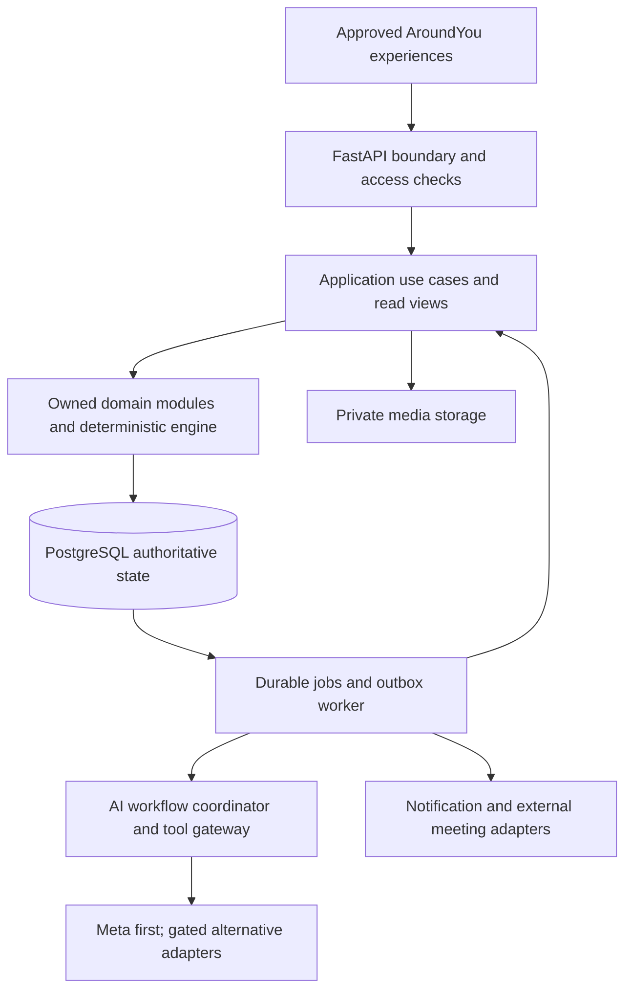

# AroundYou V1 — Backend Architecture Proposal, Round 1

**Status: proposed for human review; not approved for implementation.** Prepared 27 October 2026, Asia/Kolkata. No implementation code, schemas, migrations, infrastructure scripts, deployments, frontend components, or live model calls were created.

## 0. Basis and recommendation

**Recommendation:** a Python/FastAPI modular monolith, PostgreSQL as the authoritative store, private object storage for media, and a separate durable worker process running the same application/domain code. Start without Redis, microservices, a graph database, or a mandatory multi-agent framework. Use Meta Model API first; keep transcription and inference adapters separate.

The twenty modules remain logical ownership boundaries, grouped into a few cohesive packages. The system serves one canonical event through different permission-controlled views. Every AI result remains advisory until appropriate deterministic validation and human authorization.

### Evidence and proposal labels

- **Product requirement:** established in the four supplied understanding rounds and the current assignment.
- **Recommendation:** this document's engineering proposal; subject to review.
- **Open product decision:** behavior not settled by supplied requirements; proposed defaults do not become rules without approval.
- **Technical validation:** requires a targeted experiment or account inspection; no results are claimed.

Inputs: all four product-understanding rounds in this chat, the 39 approved UI references in `outputs/ui/imageofaroundyou/`, [Phase 1 technical study](../research/meta-ai-technical-study.md), [Phase 2 summary](../research/specialized-ai-research-summary.md), and [provider adapter study](../research/ai-provider-adapter-design.md). Earlier research documents predate the product rounds: their statements that product specs were unavailable describe that earlier context, not the present proposal.

The workspace has reference images and research, but no existing frontend source or authoritative API contracts. Preserve the approved experience and gather actual frontend contracts before integration. A screenshot cannot establish a permission, a verified metric, or a hidden state machine.

**Planning date:** 27 October 2026. **Deadline:** November 4, 2026, supplied by the user. Exact official closing time/timezone and submission obligations have not been independently confirmed here. Finish the demonstrable build by November 2 where possible; reserve November 3 and the final day for verification and submission preparation. This is a proposed schedule, not an automation or commitment of completed work.

## 1. System architecture

### 1.1 Runtime shape

One repository and application release; API and worker are distinct processes for workload isolation, not independently owned services. External model providers cannot connect directly to domain writes. The worker's use-case calls pass the same rules as HTTP-triggered actions.

### 1.2 Layers and responsibilities

| Layer | Responsibility | Boundary |
| --- | --- | --- |
| HTTP/authentication | Request parsing, verified identity, scope resolution, authorization entry checks, upload/session initiation, response filtering | No model-controlled actor or organization identity; no domain logic hidden in route handlers |
| Application/use cases | Coordinate commands, transaction boundaries, idempotency, approvals, relevant module services | Commands express actions such as confirm plan or verify receipt, not arbitrary record patches |
| Domain | Event rules, versioned plans, participation, resources, evidence, governance, meetings and outcome policies | Deterministic calculations independent of SDKs, HTTP and model hosting |
| Read views | Compose My Events, Organizer Home, Participant Workspace, public profile and sponsor portfolio | Views do not become competing sources of truth |
| Persistence | Repositories, constraints, transaction unit of work, concurrency guards, durable jobs/outbox | Each authoritative fact has one owning module |
| Worker/orchestration | Durable analysis, media processing, notifications, projection refresh, recovery | At-least-once execution with idempotent effects; not an exactly-once promise |
| Provider adapters | Model inference, ASR, optional segmentation, identity, storage, map/search and notifications | Normalize tested capabilities/errors; never silently weaken policy |
| Cross-cutting controls | Auditing, privacy, structured telemetry, cost and rate limits | Audit metadata must not leak private content |

**Recommendation:** FastAPI with Pydantic contracts; SQLAlchemy 2.x persistence with a supported async PostgreSQL driver, pinned after a small compatibility test. Prefer explicit transaction-scoped sessions. Async I/O does not make synchronous media decoding or CPU calculations nonblocking; isolate expensive processing in workers. Select supported package versions deliberately rather than assuming older research snippets represent current releases.

### 1.3 Authentication and authorization

Prefer an established identity provider supporting the approved personal/organization registration experience. AroundYou owns personal profiles, organization membership and event permissions; the identity provider establishes login identity. Validate token signature, issuer, audience, expiry and provider subject. Organization membership must be checked server-side even when an organization is selected in the UI. A personal account is not permanently an organizer account.

The precise identity vendor/session integration is an approval gate. Do not redesign the signup screen around a vendor or implement an improvised JWT/password system to save time. If browser cookies are selected, include CSRF protection; if bearer tokens are selected, define safe token handling and revocation behavior. CORS is not authorization.

### 1.4 Transactions and jobs

PostgreSQL owns domain records, approved revisions, reviews, reservations, idempotency, job state and outbox messages. A successful command commits its domain effect, audit entry and outbox messages together. External network calls never occur while a database write transaction is held open.

Recommend a small PostgreSQL-backed job mechanism for the demo: claim due work with short row-lock transactions and leases, process outside the transaction, and finish under a fencing token. PostgreSQL documents SKIP LOCKED as appropriate to queue-like consumers, while warning that it gives an inconsistent view unsuitable for general queries. Use it for queue claiming, not inventory or domain reads. [T4]

This choice trades a small amount of explicit queue logic for avoiding another infrastructure dependency. If reliable lease/retry behavior cannot be established in the first spike, adopt a supported queue library rather than inventing a large scheduler. Redis plus an established worker framework becomes justified by measured queue latency, many concurrent streams, or advanced scheduling needs. Redis must never become the only copy of reports, approvals or balances.

FastAPI documents heavier worker tools for work beyond simple in-process background tasks. Original reports and durable jobs cannot depend solely on FastAPI BackgroundTasks surviving a process restart. [T1]

### 1.5 Storage and integrations

Private object storage holds original media and derived renditions; PostgreSQL holds ownership, scope, integrity metadata, consent, retention and attachment relationships. Direct signed uploads can reduce API load; upload completion must still validate size/type/hash and quarantine status. A stored object and its database metadata do not share a transaction: use explicit pending/ready/failed states and orphan cleanup.

External providers: managed identity; PostgreSQL/object hosting; mapping/geocoding consistent with the approved real map; Meta inference/voice; optional SAM; notification delivery; externally supplied meeting links. Vendor contracts, access and regional settings remain open. No wallet, escrow, automatic government filing, or in-app video-conferencing platform is assumed.

### 1.6 Why this fits better than alternatives

| Alternative | Why not the V1 default | When reconsider |
| --- | --- | --- |
| Twenty microservices | Adds deployment, auth, tracing, message-order and cross-service transaction problems to tightly connected planning/execution | Independent teams or genuinely separate scaling/availability requirements |
| All work inside API requests | Long analysis/media processing blocks responsiveness and is fragile across disconnects | Only short deterministic commands should finish inline |
| Agent framework as domain authority | Hard to enforce ledger integrity, version checks, approval and reproducibility through prompt behavior | Use a framework only as an optional inference harness behind domain controls |
| Document-only database | Does not simplify relational permissions, commitments and multi-record integrity for this scope | A separately justified bounded document workload |
| Graph database | DAG traversal is small and testable in Python/PostgreSQL initially | Measured traversal size/latency exceeds practical limits |
| Full event sourcing | Broad replay/migration complexity under the deadline | Keep append-only audit/ledgers and immutable plan revisions without event-sourcing every entity |
| Redis-first distributed stack | Another failure/recovery path before demonstrated need | Add for justified transient coordination/cache/queue workload |

## 2. Ownership and communication for all twenty modules

Common communication rule: synchronous in-process queries/commands for consistency-sensitive use cases, with one transaction where appropriate; durable outbox events for notifications, AI work and rebuildable projections. Modules may read explicit shared projections but cannot mutate another module's private records. No internal HTTP calls are needed.

Types: **D** domain-rule owner; **W** workflow coordinator; **V** composed information view. A module can serve more than one role.

| Module | Primary responsibility and owned authoritative facts | Dependencies | Communication and type |
| --- | --- | --- | --- |
| M01 Identity & Accounts | Personal profile; sponsor organization identity/membership; event permission grants and delegations. External identity provider owns credentials | None for identity; event existence/scope from M04 | Policy queries on every command; grant/revocation commands and audit events. D |
| M02 Discovery & Maps | Search/filter/map interpretation and rebuildable discovery projection; no independent event definition | M04 event facts, M09 publication/visibility, M10 public content | Scoped read queries; refresh from publication/content events. V |
| M03 My Events & Recovery | Saved navigation/progress checkpoints and watch relationships; relationship/status views derived elsewhere | M01, M04 drafts/events, M05–M09 progress, M11 participation, M12/M13 views | Query composition; save resume context; authorization checked again on recovery. W/V |
| M04 Event Creation/Core | Creation draft, explicit creation, canonical event brief/identity, format/location/timezone, operational event lifecycle | M01 | Create/update commands; event-created/brief-revised events; no publication side effect. D |
| M05 Governance | Internal assessments, ticket/document tracking and follow-up decisions; no official legal approval | M01, M04, shared media controls | Assessment/review commands; job request to M20; references to source context. D/W |
| M06 Stage Planning | Stage definitions/revisions, stage-level dependencies and confirmation; active coordinated plan manifest | M04, optional M05 constraints; engine | Proposal/confirmation commands; synchronize manifest with M07/M08; plan-change events. D |
| M07 Work Design | Work groups/blocks, executable-work lifecycle, work dependencies/effort/volume, confirmed work revisions and resource-demand revisions | M06, M04, engine | Stage-scoped design/confirm; validated cross-owner revision activation; changed-demand events to M08/M14. D |
| M08 Actor Requirements | Role requirements/revisions, links to work, skills/headcount/commitment needs; confirmation | M07, M06, engine | Derive/propose/edit/confirm; M09 publishes chosen versions; consumers query them. D |
| M09 Setup & Publishing | Participation/question/tag configuration, invitation drafts, publication state, visibility and publication decisions | M04, M06–M08, M14 availability, M15 arrangements, M01 | Calls resource commands rather than owns duplicate stock; publishes version manifest; emits discovery/profile updates. D/W |
| M10 Public Event Profile | Public editorial content/media approvals, published presentation references; eight-tab projection | M04/M09, planning, M11, M15, M16/M18/M19 | Public filtered reads; Manage Profile commands use owner services for operational facts. D for editorial content; V otherwise |
| M11 Join & Participation | Application versions/answers/availability, approval/decline, approved participation and participant acceptance records | M01, M08 published roles, M09 settings | Application/review commands; commitment inputs to M12; participant relationship events to M03/M13. D |
| M12 Organizer Operations | Explicit work/role assignments and assignment commitment changes; coordinates organizer decisions | All event modules and M01 | Calls owning module commands; owns assignment decisions, not copies of inventory/reviews; composed Organizer Home. D/W/V |
| M13 Participant Workspace | Personal operational view; no separate work/completion or inventory authority | M11/M12 assignments, M07, M16–M18 | Scoped queries and commands to report/blocker/meeting owners. W/V |
| M14 Resources & Inventory | Source supply/stock, verified receipt ledger, reservations, consumption, returns, adjustments and corrections | M07 owns demand; M09 records facts via M14; M15 commitments; M16 verified findings | Atomic ledger/reservation commands; resource-change events; reconciliation queries. D |
| M15 Sponsorship | Sponsor offers/versions, organizer acceptance, contribution obligations, fulfillment records and disclosure preferences | M01 organization, M07 needs, M12 authorized decisions, M14, M16 | Offer/accept/fulfill commands; cross-referenced receipt or service evidence; sponsor portfolio projection. D/W/V |
| M16 Reporting & Evidence | Original reports and attachment links, AI analysis references, review/verification decisions, work-progress facts | M07, M12 assignment, M14/M15 target records, M20 | Save report+job atomically; review invokes appropriate ledger commands for validated resource effects. D/W |
| M17 Blockers & Change Control | Original blockers, assessments, affected-scope change proposals, mitigation decisions and resolution/reopening history | M06–M08, M11/M12, M14–M16, engine/M20 | Analyze/propose/approve; calls affected owner services through coordinated change use case. D/W |
| M18 Meetings & Communications | Meeting records/invitations/RSVPs, agenda/notes/follow-up proposals, discussions, notification intentions/delivery states | M01, M11/M12 people, planning, M17, optional M16/M20 | Authorized schedule/invite commands; outbox delivery; public posting separately authorized. D/W |
| M19 Impact & Insights | Metric definitions, measurement/evidence links, reviewed impact records/public releases; permitted aggregate projections | M04 goals, M11 consented answers, M14–M16 verified facts, M18 public context | Measurement/review/publish commands; rebuildable aggregates; no promotion of claims to facts. D/V |
| M20 AI & Intelligence | AI runs/attempts, input source-version manifest, prompt/schema/model versions, tool traces, proposal artifacts/validation and usage | Authorized context from owner modules; provider adapters | Bounded jobs/read tools; proposals returned to owner workflows for confirmation. D for execution provenance; W |

### Package grouping and scope

Recommended cohesion groups: identity/access (M01); event entry/read views (M02–M05); planning (M06–M08); publication/presentation (M09–M10); participation/operations (M11–M13); supply/sponsorship (M14–M15); evidence/change/coordination (M16–M18); outcomes (M19); intelligence (M20). These are code boundaries, not nine deployments. Shared infrastructure supplies media, auditing, transactions and queues without owning business meaning.

Event-level authorization is not a single global tenant flag: people may participate across events, and organizations may support many events. Explicit event/community/organization scope is checked for each operation. Community membership semantics remain a product decision; do not assume organization membership equals event authority.

## 3. Canonical domain concepts and relationships

This is a conceptual entity map, not SQL or a physical schema. Stable identities survive revisions; confirmed versions are immutable snapshots.

| Concept and owner | Relationships and authority |
| --- | --- |
| PersonalAccount / SponsorOrganization / OrganizationMembership — M01 | Person may represent organizations through approved membership, with event-specific grants separate from org roles |
| CreationDraft / Event — M04 | Draft captures incomplete brief and wizard progress; explicit idempotent creation links it to one event. Created event can remain unpublished |
| Publication / Visibility / ParticipationPolicy — M09 | Separate dimensions linked to one event; publication references approved public plan/role/content versions |
| PublicProfileContent — M10 | Editorial presentation of that event, not a second event or copy of private operational state |
| StagePlanRevision / Stage / Dependency — M06 | Event has versioned stages; active manifest identifies confirmed stage/work/role versions |
| WorkDesignRevision / WorkGroup / WorkBlock — M07 | Each block traces to parent stage and expected outcome; dependencies reference stable identities with revision context |
| ResourceRequirementRevision — M07 | Demand belongs to confirmed work and units; M14 reconciles demand but does not rewrite it |
| RoleRequirementRevision — M08 | Responsibilities/capabilities/headcount/commitment demand traces to confirmed work; not real people |
| Application / ApplicationRevision / ApprovedParticipation — M11 | Person requests published requirements; review authorizes participation; retain which requirement/version was requested |
| Availability / AcceptedCommitment — M11 and owner-specific commitments | M11 owns stated availability and participation acceptance; M12 assignments and M18 meeting responses remain authoritative sources for their intervals |
| Assignment / AssignmentChange — M12 | Approved person linked to work/responsibility and agreed timing; do not infer assignment merely from approval |
| SupplySource / InventoryMovement / Reservation — M14 | Supplies distinguish owner, custodian, event/use scope, units, usable time and condition; movements preserve receipt/use/correction history |
| SponsorOffer / AcceptedContribution / Fulfillment — M15 | Organization offer accepted by authorized event actor; fulfillment references verified receipts/services, not stock duplication |
| ProgressReport / MediaAsset / Analysis / VerificationDecision — M16 + media infrastructure/M20 | Immutable original plus reviewed corrections; decisions reference exact report/artifact versions and target work/resources |
| WorkProgressFact — M16 | Verified work progress consumed by operations/impact; M07 owns executable-work lifecycle and M06 stage lifecycle. Applying a verified finding invokes their transition rules; M16 does not independently close work/stages |
| Blocker / ImpactAssessment / ChangeProposal — M17 | Original obstacle linked to affected work; proposal describes bounded changes against a baseline; outcome/attempt history persists |
| Meeting / Invitation / Response / FollowUpProposal — M18 | Actual attendees/invitees and context; accepted follow-up creates a normal owned task/assignment through its owner |
| ImpactMetric / Measurement / ImpactRelease — M19 | Unit, method, evidence, period, uncertainty and review; completion/delivery alone cannot prove social impact |
| AIRun / Attempt / AIProposal — M20 | Provider-bound execution and immutable advisory artifact; accepted artifact references domain revision actually committed |
| ApprovalDecision / AuditEntry / OutboxEvent — relevant owner + shared infrastructure | Decision is owned by the business workflow; common audit storage is not an independent approval authority |

There is no generic JSON document entitled to mutate all these concepts. JSON may store immutable proposal payloads or metadata, but domain relationships and critical invariants remain explicitly represented and validated.

## 4. Lifecycle, versions and authorized transitions

All state names in this section are **recommended candidates**, not declarations that unresolved product states have been approved. Keep separate state machines rather than one event status trying to express planning, publication, governance and execution simultaneously.

| Concern | Proposed lifecycle / representation | Guards and human decisions |
| --- | --- | --- |
| Creation draft | Editing → converted or discarded; separate save checkpoint | Creator permission; autosave expected version; Create has idempotency key; converted draft links original event rather than creates another |
| Operational event | Created/planning → ready/active → completed; cancelled/archived separately if approved | Organizer command, applicable completion checks; not inferred from publication or AI |
| Publication | Unpublished → published → withdrawn; scheduled publication optional later | Explicit authorized release; checklist based on agreed rules; versioned release. Scheduling is a delayed authorized command, not a new visibility |
| Visibility | Public / unlisted / private as candidate access policies | Separate from publication; changing access immediately affects discovery, API/media permissions and pending notifications |
| Plan/work/roles | Draft → validated proposal → confirmed revision; prior confirmed revision superseded | Human confirmation, dependency/feasibility checks, expected baseline; revisions do not erase history |
| Published opportunity | Explicit published version, open/closed availability as separate facts | Based on confirmed requirements; applicant count does not establish approval or slot reservation |
| Application | Draft → submitted/pending → approved or declined; withdrawal/edit policy open | Applicant submits; authorized reviewer decides against latest role/application versions |
| Approved participation | Active authorization with possible later suspension/withdrawal policy | Distinct from actual accepted responsibility and assignment |
| Assignment | Proposed → accepted/active → ended; reconfirmation required for agreed material changes | Approved participation, capacity/permission checks, participant agreement policy; multi-role does not bypass time checks |
| Resource | Separate offer/receipt/reservation/movement facts, not one linear stock status | Accepted offer has no on-hand effect; verified receipt and authorized movement update ledger |
| Report and review | Saved submission; analysis queued/running/succeeded/failed independently; review pending/clarification/verified/unsupported | Review targets exact source revision; partial verification allowed only under an approved rule |
| Blocker | Reported/reviewed/being handled/resolved/reopened as conceptual conditions | Exact vocabulary and resolution authority open; mitigation application does not imply resolution |
| Meeting | Suggested → authorized scheduled → held/cancelled; RSVP separately | No model-created invitation authority; record actual attendance separately from RSVP |
| Impact | Candidate measurement → reviewed → approved public release; corrected/superseded | Qualified evidence and disclosure checks; old published value corrected visibly |
| AI proposal | Generated → validated or invalid → pending human review → applied/rejected/stale/expired | Structural + semantic validation; acceptance does not equal applied unless domain transaction succeeds |

### 4.1 Coordinated plan revision

Recommend immutable confirmed stage/work/role revisions with an event PlanManifest identifying the active compatible set. M06 owns manifest activation; M07/M08 own their content and validation. A planning application use case calls their services in one transaction, rather than allowing M06 to write their records directly.

A proposed revision records stable target IDs, baseline versions, the exact diff, affected set, validation results and required acknowledgements. Human approval binds this specific content and preconditions. Apply by comparing expected versions, rechecking policy/feasibility and atomically activating a coherent manifest plus audit/outbox records. Do not change a parent stage while leaving invalid child work silently confirmed.

Conservative demo recommendation: no automatic activation when affected accepted commitments lack required reconfirmation. Keep the current confirmed revision active and show the candidate change/obstacle; do not pretend the old plan is still feasible if known facts contradict it. Mark affected work at risk/blocked according to approved execution rules. Emergency overrides and staged activation need explicit product approval.

Not every change invalidates every proposal. Track a dependency-version vector: stage/work/role versions, relevant availability/reservations, source evidence and policy. An unrelated profile spelling change should not stale a resource proposal; a changed demand or approval policy should. First iteration may conservatively invalidate the bounded planning scope rather than attempt clever merging.

### 4.2 Publication and public read consistency

Publication references a reviewed public content/plan/opportunity manifest. Organizer operational facts remain authoritative; public summaries are deliberate permitted projections. A release must not copy private notes or applicant answers. Revisions affecting advertised opportunities require an explicit reviewed update and handling of existing applicants/participants; exact policies are open.

Do not independently publish stale projections after a visibility change. Every public request checks current publication/visibility before returning a cached/materialized payload. Immediately invalidate or gate old public media when access is restricted, with any unavoidable signed-URL expiry window documented.

### 4.3 Cross-cutting command checks

Before a consequential change: verify authenticated actor and current grant, resolve correct event/organization scope, check expected record versions, validate proposal/approval freshness, enforce domain rules, then commit effect + decision/audit + outbox atomically. Recheck revocation races using the relevant authorization version/locking discipline for sensitive commands. Worker identity is not a substitute for the initiating actor's continuing authority.

Permission, version and feasibility failures return explicit conflicts; never default to last-write-wins. A human clicking Accept cannot make invalid arithmetic, another event's record, or an expired approval valid. A participant reconfirmation binds the changed commitment version, not a vague blanket agreement to future changes.

## 5. Deterministic planning and execution engine

Recommend a small pure-Python domain calculation package with explicit inputs, units, calendars and versioned results. It does not import a model SDK. Reuse it from manual edits, AI proposal validation, preview, confirmation and blocker analysis so the same rules apply everywhere.

### 5.1 Graphs and hierarchy

Stages group work; work groups organize responsibility; dependencies express scheduling prerequisites. Hierarchy and prerequisite relationships are different graphs. Recommend a directed acyclic dependency graph (DAG) for confirmed executable work and a compatible stage summary graph. Validate missing references, cross-event edges, self-edges and cycles before confirmation; return a comprehensible cycle path.

For the initial slice, propose finish-to-start dependencies with non-negative lag; other dependency types are deferred unless the approved UI requires them. This is an approval decision, not a silent restriction on the product. Cross-stage work dependencies can be supported explicitly, but stage summaries must be checked against leaf-work constraints; do not infer every detailed work edge from a broad stage arrow.

Topological traversal computes ordering and earliest feasible bounds. Traversal can be O(V+E) for a fixed DAG; resource/people-constrained scheduling is a different, harder problem and must not be claimed solved by topological sorting.

### 5.2 Relative-day Gantt and time semantics

Store/compute relative offsets and durations using explicit interval semantics; recommend half-open intervals [start, finish) internally. For continuous time units, finish = start + duration. A displayed Day 1 corresponds to offset zero. For finish-to-start edge u→v with lag L, require start(v) ≥ finish(u)+L. EarliestStart(v) = max(earliest allowed start(v), max predecessor finish+lag).

A displayed three-day inclusive bar is not three days plus its endpoint. Define granularity and day-label rendering before coding. Stage bars can initially define approved windows, with child work constrained inside them; subsequent aggregates must not silently redefine those windows.

Separate relative planning from calendar anchoring. Event timezone, day-zero anchor, working sessions, breaks and non-working days map planned offsets to actual intervals when needed. Do not use server-local dates or treat a person-day as 24 working hours. UTC instants plus an IANA timezone and local scheduling intent support unambiguous comparisons; DST ambiguities require explicit validation. Exact Day 1/event-window semantics remain a critical product decision.

Stage Planning keeps relative-day display. Participant schedules and meetings need actual dates/times; this does not replace the approved Gantt with a calendar-date design. A fixed confirmed event window is a constraint, not permission for a schedule algorithm to move the event.

### 5.3 Volume, effort, duration, capacity

Volume Q has a unit (e.g. 12 sites, 100 packs). Effort E has person-hours. Duration D is elapsed schedule time. If an approved productivity estimate r is expressed in units/person-hour, a simple estimate is E=Q/r; do not apply it when there is no meaningful r, fixed overhead or parallelism is constrained.

With n interchangeable people, h usable hours/person/day and no other limiting factor, daily capacity is n×h person-hours/day. E ≤ available capacity over the window is necessary, not sufficient: skills, prerequisites, tools, travel, concurrency and attendance can still make the plan impossible. Recommended headcount lower bound for a uniform window is ceil(E/(h×D_working_days)); it is not an automatic assignment or universally valid staffing formula.

Example: 12 site visits estimated at 2 person-hours each imply 24 person-hours. Two people each offering four usable hours/day need at least three working days under ideal assumptions. Compressing to two days leaves only 16 person-hours: reveal the deficit; do not change 12 sites into eight silently. Four people might provide enough effort, but transport capacity or a prerequisite can still prevent compression.

AI can suggest E, r, range and assumptions; organizer confirms relevant estimates. Deterministic code computes feasibility against those estimates, preserving uncertainty. Do not report an AI effort estimate as measured productivity or derive precise claims from false precision.

### 5.4 Role requirements and assignments

Use confirmed work to collect capability/responsibility needs, commitment windows and estimated effort. AI proposes role names/grouping/skill descriptions. Deterministic checks verify every requirement's source work, valid units/counts, coverage and assumptions, and flag uncovered responsibilities or implausible staffing.

Do not automatically add headcounts across sequential work when the same people could serve both, or assume that they can when skills/timing differ. A role's estimated headcount is demand; selected/approved applicants and assigned people are separate counts. Published role versions remain linked to the work manifest used by the application.

For assignment, verify approved participation, eligible role/work scope, accepted commitment, and actual interval fit. Recommend comparing a person's assignments and accepted meeting commitments across events through a privacy-preserving busy/free query. Other organizers see a conflict, not the private event's title or details. Availability is permission to consider a window, not an agreement to every assignment inside it.

A non-overlap check alone is insufficient where travel/setup is relevant; buffer rules require approval. Serialize competing assignments for the same person/interval policy, or use an equivalent database-enforced strategy. Reading availability and then independently inserting two assignments can race. Meeting RSVP, proposed assignment and accepted work are not merged into one invented calendar source of truth.

### 5.5 Resource reconciliation and accounting

M07 owns demand per work/version; M14 owns actual supply/movements. Normalize compatible units explicitly, preserve raw claims and approved conversion factors, and use exact decimals for divisible quantities/money. Do not convert boxes into items without known pack size, or combine currencies without an approved conversion policy.

Recommended initial resource strategies, subject to approval:

- Consumables: quantity ledger plus reservations; consumption reduces on-hand and its associated reservation.
- Reusable assets: identity or capacity with time-window reservations and condition/return records; use is not destruction.
- Services/facilities/transport: time-bound capacity and fulfillment evidence, not fictional warehouse stock.
- Funding: external contribution/receipt evidence and currency; no payment settlement, wallet, or inventory units.

For a consumable source, OnHand = verified receipts + approved inbound adjustments/returns − verified consumption − outbound movements/retirement. Outstanding reservations and quarantined amounts remain part of OnHand but not free supply. FreeUsable = OnHand − outstanding reservations − excluded/quarantined stock, with categories designed not to overlap. Consuming a reserved quantity decreases both on-hand and that reservation; do not subtract it twice. Corrections are linked reversals/adjustments, not destructive edits.

A forecast with accepted pledges is shown separately from current usable supply. Unallocated demand gap can compare remaining compatible demand against free usable supply for the needed time/location; it must account for reservations already covering that demand. Do not sum independent per-work shortages and double-count shared resources.

For reusable asset a, sum of overlapping reserved capacity must not exceed its usable capacity at any time. Check units, ownership/custody, delivery time, location, condition and allowed use. An accepted promise cannot satisfy this current-availability constraint. Scope shared assets by their real owner/source, not duplicate copies under each event; demo can use event-local sources and explicitly defer cross-event shared inventory.

Receipt command: validate exact verified finding and remaining receivable quantity, lock source/obligation as necessary, record receipt once and link sponsor fulfillment where relevant. Reservation command: lock compatible stock/capacity, re-evaluate availability, commit reservation. Use a stable lock order; retry deadlocks/serialization failures only for safe idempotent transactions. PostgreSQL row locks/isolation provide primitives, not an automatic business invariant. [T2–T3]

### 5.6 Selective propagation and blocker replanning

Given changed work set S: collect descendants in the dependency graph; relevant ancestors/parents for summary windows; linked role/resource requirements; assignments, reservations, sponsor obligations and meetings whose facts are actually affected. Reachable schedule descendants are not the whole impact set: a shared asset or person can create lateral conflicts with otherwise unrelated work. Include those conflicts in the report without automatically rewriting them.

Compute old/new bounds, requirement deltas, commitment mismatches, and public-release differences. Present a bounded impact report with baseline versions and unresolved conflicts. Distinguish computed consequences from AI mitigation suggestions. Do not auto-commit every earliest-start recomputation: confirmed timings may be promises.

For a blocker, first assess deterministic affected scope; then ask AI for alternatives only within an allowed change envelope and current constraints. Revalidate each alternative with the engine. If the proposed scope expands, require a new impact assessment and authorization. If no feasible option exists, show that result and escalate; do not let the model invent resources/people or weaken constraints.

Illustration: a printing delay affects handout preparation and the workshop that depends on it. Tutor commitments and sponsor delivery timing are at risk. A separate already-completed outreach stage stays unchanged. Sharing a room with another workshop may reveal an additional conflict; it is a reason to review that relationship, not to regenerate the other workshop.

## 6. AI orchestration without unnecessary agents

### 6.1 Match workflow complexity to the task

A single structured model call should be the default. An agent loop is justified only when the model must choose among bounded authorized information-gathering/calculation steps based on observations. A fixed media pipeline is a job workflow, not an autonomous agent. Multiple analysis roles can share a model; no mandatory agent per module or peer-to-peer swarm.

| Workflow | Initial AI shape | Required context | Deterministic/human boundary |
| --- | --- | --- | --- |
| Stage Planning | Single structured proposal; bounded read-tool loop only for missing scoped context/history | Event goal/scope, constraints, schedule assumptions, optional governance findings, verified similar outcomes | DAG/timing/effort checks; organizer confirms |
| Work Design | Structured call for selected stage; bounded contextual revision loop | Confirmed stage/version, existing work, risks, resources, requested edit | Parent/edge/units/feasibility checks; explicit diff acceptance |
| Actor Requirements | Single structured draft plus deterministic feasibility | Confirmed work/capability needs/effort/windows | Source-work coverage/count validation; organizer confirms; no invented people |
| Participation advice | Optional single recommendation | Applicant-authorized information, published role version, availability and conflict summary | Eligibility/slots/conflicts and approval are domain decisions; no model ranking as automatic admission |
| Sponsor Fit | Single explanatory call | Organization capabilities/causes/region, authorized event needs and offer | Advisory only; no acceptance/negotiation authority |
| Blocker mitigation | Bounded agent when alternatives require iterative calculation | Original blocker, computed affected scope, current versions/constraints/commitments | Read/calculation tools only; feasible diff + authorized change command |
| Meeting suggestions | Deterministic candidate windows, optional structured agenda/attendee explanation | Actual permitted people/free-busy/context/purpose | Explicit schedule/invitation actions; follow-up is not assignment |
| Multimodal reporting | Fixed asynchronous transcription/interpretation/optional segmentation stages | Consented source media, linked work/report, allowed claims | Original saved first; separate review; source/quantity validation before effect |
| Historical analysis | Deterministic permission-filtered retrieval plus single source-citing synthesis | Verified outcome records with dates/methods/limitations | No source-status upgrades or model training; reviewers approve reuse/disclosure |

Actor-count derivation, schedule calculations, graph traversal, balances, invitation authorization, assignment, public aggregation, quorum/policy rules if supplied, and lifecycle transitions remain deterministic even when a model narrates them.

### 6.2 Proposal lifecycle and context

M20 creates an AIRun with workflow ID, actor/event scope, input record/version manifest, source IDs, prompt/schema/tool versions, provider/model, limits and privacy profile. Store only context necessary to reproduce/debug within retention rules; a context hash plus selected references can be preferable to indefinitely retaining private prompts.

Generate structured advisory content. Validate in layers: transport completion → JSON/schema → references/units/enums → source ownership/permissions → domain calculations → contradictions/unknowns → current baseline. Schema-constrained JSON is not evidence of truth. Contradictory role counts, missing dependencies or unsupported quantities fail review readiness even if the JSON parses.

Return a proposal and impact preview, never an automatic operational mutation. Owner modules perform confirm/apply with expected versions and an approval record. For an ordinary authorized manual decision, that command can itself record the human decision; do not require a redundant two-click approval ceremony unless product policy needs one. For an AI change, the human must be approving a concrete diff, not an unspecified future action.

If a source changes while inference runs, record model completion but mark the proposal stale where relevant; do not overwrite new state. If the human edits a generated diff, create a new version and revalidate. A prior approval does not cover different content.

### 6.3 Tools, execution bounds and failure

Allowlist narrow tools such as read authorized event context, retrieve verified outcomes, calculate candidate schedule, assess conflicts, and summarize resource gap. Tool arguments are untrusted; inject actor/scope, validate schema, enforce ownership/current policy and bound output size. No SQL, shell, arbitrary URL fetching, arbitrary registry imports or direct publish/assign/verify tools exposed to the model.

Recommended starting limits for a genuine agent run: six model turns, twelve client read/calculation calls, bounded tokens and a configured monetary ceiling; up to three inference attempts within the same overall deadline. These are experimental caps requiring tuning/approval, not validated performance. Media jobs use duration/size limits and separate deadlines. All nested work consumes the parent budget; tool retries do not reset it.

Meta currently documents only auto tool choice and says max_tool_calls applies to built-ins, not client functions. Therefore, the application loop must enforce its own limits and handle plain replies instead of assumed forced calls. [T7]

Parse streamed arguments only when complete; terminal error/incomplete output cannot become an applied proposal. Cancellation prevents future tool dispatch even if a provider continues running. Keep successful advisory output separate from successfully applying a change.

### 6.4 Provider abstraction and capability profiles

Use separate inference, transcription and segmentation ports. Each profile records provider/model/protocol, documentation date, contract-test status, structured-output subset, tool/reasoning/replay behavior, media/size/context/output limits, usage units, retention/region and pricing. Mark untested required features unavailable to routing; do not equate generic OpenAI compatibility with complete parity.

| Provider | Proposed role | Gate |
| --- | --- | --- |
| Meta Model API | Initial inference; Muse Voice for initial voice candidate; SAM selectively if justified | Access and small contract tests; privacy/cost approval; explicit storage and reasoning budget |
| Modal Spark Open | Later optional comparison/alternate inference | Exact endpoint/model, strict schemas/tools/media/replay and eligible funding verified |
| Baseten Spark Open | Limited advisory/read-tool fallback | Current docs exclude Spark structured outputs/JSON mode; do not route strict-output-required workflows here |
| AssemblyAI | Optional transcription alternative already researched | Language/word-timing/privacy/cost tests; independent of inference provider choice |

Meta Responses documents encrypted replay or stored response continuation. Keep opaque reasoning/response IDs provider-bound; the PostgreSQL domain history remains authoritative regardless of provider storage. [T6] Baseten explicitly excludes Spark strict outputs/JSON mode. [T8] Modal plan credits exclude Shared usage; promotional exceptions and account access remain unverified. [T9]

Do not silently fail over sensitive context, downgrade schemas, or concatenate two providers' partial responses. Fallback is an explicit new attempt from approved compatible context. Provider changes need capability/privacy checks, not a frontend or domain workflow rewrite.

## 7. API and asynchronous processing strategy

### 7.1 Endpoint groups, not exhaustive routes

Use a versioned HTTP contract with Pydantic request/response models; actual field names must be reconciled with approved frontend behavior before implementation. Response models separate public, organizer, participant and sponsor disclosure. Do not return ORM objects indiscriminately.

| Endpoint group | Request/response boundary | Execution |
| --- | --- | --- |
| Accounts / organization context | Verified identity, permitted organization profiles/membership | Short authenticated reads/commands |
| Discovery / public profiles | Search/map bounds, filters, canonical public content only | Indexed filtered reads; versioned/publication-gated projection |
| My Events / drafts / event core | Saved wizard input/checkpoint, create command, resume target | Transactional idempotent saves/create; reauthorize resume |
| Governance | Event context, assessment/ticket/doc references | Save inline; optional analysis job; no external filing |
| Planning / work / roles | Expected baseline, manual or AI-generated diffs, impact preview, confirm | Short validations inline; AI/expensive assessments queued |
| Setup / release / profile management | Participation/questions/settings, reviewed public manifest, publish decision | Authorized versioned commands; projection/outbox updates |
| Participation / assignments | Versioned application/availability/review and assignment decisions | Atomic approvals/assignments; conflict outcomes |
| Resources / sponsorship | Offers, acceptance, evidence refs, reservation/receipt/use decisions | Guarded ledger transactions, no promise-as-stock mutation |
| Reports / uploads / reviews | Authorized source asset refs, claims, review decisions | Save report first; queued processing; verified effect transactional |
| Blockers / changes | Original report, affected baseline, proposed diff, approval | Durable assessment; atomic bounded revision activation |
| Meetings / discussions / notifications | Permitted audience, meeting facts, draft/final communication | Save intent; send via outbox; no direct AI invitations |
| Insights / outcomes | Source-linked measurement, release decision, aggregate request | Guarded measurement/release; recomputable aggregates |
| AI jobs / progress | Workflow request with trusted scope, job state/cursor, proposal ref | 202 accepted for async; authorized polling, optional SSE |

Recommend 201/200 for successful short creation/update, 202 for accepted analysis, 401/403 for identity/access, 409 for business-state conflict, 412 for failed If-Match precondition where used, 422 for invalid input, and 429 for throttling. Error envelopes should give safe code, correlation ID, field issues and permitted recovery details; do not reveal another person's private schedule.

### 7.2 Idempotency and concurrency

Require idempotency on create/submit/confirm/verify/receive/consume/publish/invite operations with retry consequences. Scope keys to authenticated actor, operation and event/organization; retain request hash and result reference. Same key+same payload returns the original outcome; same key+different payload conflicts. Define retention and handling of in-progress/expired keys. A stored outcome containing media URLs must regenerate authorized short-lived links, not return expired or now-forbidden URLs.

Idempotency is not duplicate-content detection. Two distinct keys can submit the same photograph; a hash can flag it, but semantic duplication needs review. A report can be saved twice accidentally without counting two verified effects. Authoritative receipt/use/progress commands also reference a unique effect/finding identity.

Recommend compare-and-swap versions for normal edits; row locks for shared resource balances, assignment contention and other cross-row invariants. Read Committed plus explicit locks/constraints is a pragmatic default; use Serializable for narrowly justified predicates with safe whole-transaction retries. Version counters alone do not stop write skew across multiple records. SQLAlchemy warns that its per-object version mechanism does not protect bulk multirow operations; guard those explicitly. [T2–T5]

Lock in a stable order and keep transactions short. One transaction-scoped session per concurrent task; never share mutable transaction state among worker coroutines. Recheck related versions atomically at application, not merely at preview time.

### 7.3 Job and notification mechanics

Durable job fields conceptually include job/workflow ID, scope, input manifest, state, attempt count, next attempt time, lease/heartbeat/fencing token, deadline, cancellation and output/error refs. Proposed job states: queued/running/succeeded/failed/cancelled; stale output is a separate proposal result, not a failed database write.

Worker sequence: claim briefly → release DB transaction → external operation → persist attempt/artifact under lease/version check → enqueue next dependent step. Reclaim expired leases with bounded retry. Reject late results from superseded workers from producing duplicate domain effects, though preserve useful sanitized attempt metadata. External inference may still incur duplicate cost after uncertain timeouts; no exactly-once external promise is possible.

Report receipt commits original metadata and analysis job together after media is ready or explicitly pending validation. If AI is down, the report is still available for human review; failures never erase it. File/chunk offsets preserve media provenance. Process only needed modalities; a text update does not launch transcription or SAM.

Outbox delivery is at least once with per-recipient deduplication and provider message IDs where supported. Email/webhook providers may not guarantee exactly-once display after an ambiguous send; record that limitation. Public notifications require a currently permitted audience/content check at dispatch. Failed notification delivery never rolls back already committed verified progress; expose delivery status separately.

### 7.4 Progress and recovery

Start with authenticated job polling; add SSE only if integration time and testing permit. Stream application-level status/events with a persisted sequence/cursor and always allow authoritative state refresh. Do not make a transient broker or browser stream the only copy of results. Avoid holding database transactions/connections for the lifetime of a stream. Cross-instance SSE can poll durable records initially; Redis fanout is optional later.

Media uploads use private signed intent, bounded upload, completion validation/quarantine, then authorized attachment. Failed uploads do not create verified evidence; orphaned objects are reconciled. Job/worker restart, browser refresh and My Events recovery use durable IDs/checkpoints and current permissions. Frontend disconnect versus capture cancellation needs explicit policy; never assume a disconnected viewer ended a billable live audio session.

## 8. Security, reliability, testing and observability

### 8.1 Access and sensitive information

Deny by default; enforce resource-level policy on every read, command, download, stream subscription and tool call. Event grants distinguish organizer, delegated stage/work scope, participant and sponsor; organization roles independently govern offers/profile actions. A sponsor offer never creates event-admin permission. Approval revocation and membership changes must affect subsequent commands and media links, not just menu visibility.

Select actual fields for each view. Public stages omit private estimates/notes; public Updates and Discussions cannot inherit operational messages automatically. Applicant answers, email/phone, demographics and availability are private unless a specific authorized use permits disclosure. Error messages/counts/search results also need filtering. Restrict mass assignment of role, review, lifecycle or organization fields.

Audio/meeting recording needs explicit consent and visible capture policy before provider processing. Demographic collection and aggregate disclosure are different permissions; new questions are voluntary for existing participants as specified. Until suppression thresholds/denominators are approved, keep public demographic output unavailable rather than choose an arbitrary threshold or fabricate numbers. Sponsor insights expose relevant verified contributions, not unrelated participant data.

Original evidence is preserved for review within the agreed retention policy, not forever regardless of consent/deletion requirements. Retain a minimal audit trail with protected references/tombstones where appropriate; do not put raw media or private answers into irreversible audit text. Deletion must consider source objects, derived files/transcripts, provider data, search indexes, summaries and cached public links.

### 8.2 Upload and provider security

Allowlisted decoded formats, byte/duration/dimension limits, generated object names, private buckets and scoped signed URLs. Verify content rather than trust extension/MIME headers. Quarantine untrusted media, scan where appropriate, disallow executable/active-content rendering and isolate decoding with resource limits. Downloads require authorization. Consent/ownership checks precede model submission. No arbitrary user URL ingestion in the demo; later fetchers need SSRF, redirect, DNS and destination controls.

Keep secrets server-side and out of traces; use separate provider scopes/environments and explicit allowed model IDs. Treat OCR/transcripts/web pages/tool outputs as untrusted prompt content. They cannot modify tools, budgets, policy or approval. No background job silently exports private context to an alternate provider.

### 8.3 Integrity and recoverability

Database constraints support unique effects/keys, valid references and local quantity bounds; services enforce cross-record/domain invariants under locks/isolation. No generic administrative endpoint bypasses the domain ledger. Preserve audit actor, action, targets, source/expected versions, decision reason, timestamp and correlation ID. Audit records are append-only for normal application roles, but not falsely advertised as tamper-proof against database administrators.

Use backups and a restore rehearsal before a public demo environment holds important state. Verify object references and reports after restore, not merely database connectivity. Keep migrations/deployments a later separately authorized activity. Liveness and readiness distinguish process health from DB/worker/provider degradation; optional AI failure should not make saved reports disappear or every read fail.

### 8.4 Rate, inference and cost controls

Limit requests/uploads/recording durations per actor and event, and provider jobs/concurrency globally. Begin with durable PostgreSQL budget reservations and bounded worker concurrency; use Redis only if distributed rate counters justify it. Fail safely when budget checks cannot be performed. Configure a per-run and daily allowance before any live tests; this proposal neither requests credentials nor authorizes charges.

Track billed model usage with cached/uncached input and output; reasoning is a subset where the provider counts it that way. ASR audio duration and streaming connection duration are different units. Aggregate attempts, retries and abandoned jobs. Unknown usage remains estimated until reconciliation. Expired worker leases do not make provider spending vanish. Sensitive-data minimization and a reviewable manual fallback are product reliability features, not merely model settings.

### 8.5 Test strategy and release evidence

| Test class | Meaningful acceptance evidence |
| --- | --- |
| Domain unit/property tests | DAG cycle detection; interval bounds; no volume loss from duration edit; unit-safe capacity; conservation of stock; stale revisions rejected |
| PostgreSQL integration | Two concurrent stock reservations cannot overdraw; duplicate receipt effect applied once; two assignment approvals cannot bypass conflict policy; rollback preserves atomicity |
| Permission matrix | Personal/org/event/stage scopes; revoked delegate; wrong community; public DTO/media/error privacy; zero forbidden writes/leaks |
| Workflow integration | Draft resume → creation → confirmation/publication → application/assignment → report/review → qualified impact |
| Worker fault injection | Crash after report save, after provider acknowledgement, during lease expiry, and after commit before notification; no lost original/duplicate domain effect |
| Provider contracts | Actual tested model/endpoint/schema/tools/stream finality/media limits; mocked failures separated from live access tests |
| AI quality evaluation | Representative categories and Hindi-English corpus; evidence/source accuracy, proposal acceptance/correction, no autonomous mutations |
| UI contract tests | Four creation/join steps; same canonical eight-tab profile; correct resume contexts; no extra wizard stages or invented data |
| Recovery/operations | Backup restore, pending-job resumption, budget exhaustion/cancellation, visibility restriction and media revocation |

Start with synthetic fixtures clearly labelled as fixtures, not real community achievements. Mocked models test workflow behavior, not provider compatibility. A demo claiming real Meta integration must include a successful bounded live contract and workflow test after authorization; if unavailable, disclose it rather than disguise recorded output as live inference.

Observability: structured logs and traces by request/event/run/job/attempt; counters for queue age, failed/retried jobs, version conflicts, forbidden operations, stale proposals, outbox backlog, provider latency/errors, reviewer backlog and spend. Track p50/p95 response and workflow latency separately from provider generation. Redact private content; do not persist private chain-of-thought. Alerts and dashboards should distinguish domain success, AI success and notification success.

## 9. Implementation sequencing toward November 4

This is a proposed order, **not permission to begin coding**. The architecture covers all modules; the demo need not implement all of them. One capable contributor or a small team has limited time; these dates are targets contingent on approval, access and actual frontend availability, not guarantees.

### 9.1 Demonstration tiers

| Tier | Intended working scope | Explicit boundaries |
| --- | --- | --- |
| Essential end-to-end | Personal identity/event access; four-step draft/recovery/create; Meta stage/work proposal with manual edit and explicit confirm; role requirements; actual resource gap; finalize/publish canonical profile; four-step join request; human approval and explicit assignment; saved text/voice-or-image report; AI analysis; human verification; qualified outcome; one selective blocker-change case | Keep categories general; do not fabricate demographics/impact, auto-assign or auto-verify |
| Reduced but real | Basic org registration/offer/acceptance and verified material receipt; manual meeting/link/invitation records; internal governance ticket/doc tracking; basic search and real map-backed locations; notifications as actual in-app records; simple source-linked historical query | Manual/external links where approved; no automatic government filings, payment settlement, claimed calendar sync or unverified AI meeting scheduling |
| Architecturally supported, possibly unfinished | Full live audio/meeting ASR, advanced SAM/video, sophisticated multi-agent investigation, cross-event shared stock, automatic scheduling optimization, broad metrics/consented demographic aggregates, complete moderation, provider failover and polished sponsor intelligence | Label unavailable/unfinished, do not populate realistic-looking successes or expose unsafe placeholder actions |

The essential narrative spans organizer → participant → reviewer and highlights one realistic blocker with controlled recovery. A sponsor receipt can enrich the same narrative if stable. Every tier still uses the same source ownership and permission boundaries; demo shortcuts cannot make accepted pledges into stock.

### 9.2 Proposed calendar and checkpoints

| Dates (user timezone) | Working vertical slice | Exit evidence and fallback |
| --- | --- | --- |
| Oct 27–28 | Identity + event draft/core + My Events recovery | Real actor isolation, saved wizard checkpoint, idempotent created event, unpublished and Not Assessed distinctions; resolve frontend/auth blockers first |
| Oct 28–29 | Stage/work planning through confirmation | Relative-day DAG engine + bounded Meta proposal + human confirm + stale rejection; if access blocked, manual planning can work but live AI claim remains unavailable |
| Oct 29–30 | Work→roles→setup→publication | Traceable demand/roles, real gap, separate visibility/publication, one canonical public representation; invitation/tag manager remains in intended context |
| Oct 30–31 | Join→approval→assignment→workspace | Four application steps, actual status, separate assignment, overlap test and saved recovery |
| Nov 1 | Report→analysis→review→progress/impact | Original survives worker failure; at least one tested justified modality; no delivery/completion/impact conflation |
| Nov 2 | Blocker recovery and reduced sponsor/meeting slice if stable | Bounded impact diff, authorized versioned revision, appropriate reconfirmation/notification; one accepted-vs-delivered contribution test |
| Nov 3 | Freeze demo scope, fix, restore/rehearse, prepare evidence | Multi-user/category regression, failure walkthrough, clean seeded dataset, honest feature list, screenshots/demo materials |
| Nov 4 | Final readiness and submission buffer | Verify actual deadline/timezone and requirements; no new architectural expansion or automatic submission assumed |

Map all modules to planned tiers: M01–M04 essential entry; M05 reduced; M06–M14 essential core with advanced options deferred; M15 reduced; M16–M17 essential narrow case; M18 reduced manual coordination; M19 essential verified basic outcomes but advanced analytics deferred; M20 essential bounded Meta workflows, alternative providers/advanced agents deferred.

**Scope-cut order:** remove optional Muse Image, live streaming/meeting ASR, SAM/video breadth, alternative inference providers, advanced matching/optimization and public demographic analytics first. Preserve permissions, draft recovery, durable original reports, human confirmation, version checks and stock integrity. If the end-to-end path is not stable by Nov 2, stop adding optional features and explicitly mark unfinished modules.

**Critical dependency:** approved UI images are available but frontend source is not. Obtain actual source/contracts without redesign before promising a fully integrated UI demo. API contract tests alone do not prove the approved frontend works. Confirmed access to auth/database/storage/model providers and a test budget are prerequisites; do not assume promotional credits or deploy resources to satisfy the schedule.

## 10. Trade-offs, open decisions and technical experiments

### 10.1 Major trade-offs and risks

The modular monolith makes multi-record business decisions easier to commit and audit, but module boundaries require discipline. Read views can accidentally become shadow owners; prohibit duplicate ledger/application state. The same release couples features, so keep optional provider failure isolated and migrations reviewable.

PostgreSQL jobs minimize infrastructure but require explicit leases/retries/monitoring and queue cleanup. Low demo load makes that reasonable only if crash tests pass. A supported worker framework is the fallback; building a generalized workflow engine is not a goal.

Immutable revisions simplify staleness/audit but increase storage and UI conflict handling. Conservative rejection is safer than automatic merge under the deadline. Append-only resource/audit history does not mean full event sourcing. Privacy deletion can coexist with minimal version metadata but requires a documented retention design.

Simple DAG feasibility and capacity lower bounds explain conflicts but are not a global optimal scheduler. Cross-event people/assets introduce privacy and concurrency complexity. Keep their representation compatible, implement only explicitly scoped initial policies, and do not claim infeasibility is solved by AI.

Hosted AI accelerates planning assistance but introduces account/cost/latency and schema limitations. Manual deterministic workflows must still function. No architecture choice can substitute for verifying model output against actual AroundYou tasks.

### 10.2 Open product decisions to settle

- Exact created/planning/execution/completion/cancellation states, who may transition them, and required closure evidence.
- Visibility mapping: public/unlisted/private versus screenshot community-only/invite-only labels; discovery and link access semantics.
- Creation requiredness and distinction between incomplete wizard draft and created-but-unpublished event.
- Day 1 anchor, working calendars, timezone behavior, fixed-window feasibility and allowable dependency types.
- Assignment agreement, multi-role capacity, partial approvals, slot holding/overbooking/waitlist and application withdrawal/edit rules.
- Material-change/reconfirmation criteria, emergency override, and what remains executable while a change waits.
- Stage/work delegate permission matrix, organization representation and revocation behavior.
- Resource unit/type policies, stock ownership, partial/disputed delivery, corrections, reusable returns and service verification.
- Evidence reviewer authority, self-review, duplicate/contradictory evidence and partial verification standards.
- Blocker severity/states, escalation and resolution/reopening rules; these remain experimental.
- Meeting invitation/RSVP/attendance/notes/transcription consent and follow-up ownership.
- Public measurement/attribution standards, corrections, demographic consent/thresholds and counting denominators.
- Media/provider retention, permitted historical reuse, region/privacy policy and sponsor disclosure.

### 10.3 Technical experiments required

1. FastAPI/Pydantic/SQLAlchemy/driver and PostgreSQL version pin with async transaction tests; no shared concurrent session.
2. Worker crash/lease/fencing/idempotency spike versus a maintained queue library; measure DB polling overhead before adding Redis.
3. Meta structured-schema, reasoning/tool and multimodal contract tests, plus proof original reports survive failures.
4. Deterministic DAG/relative-time/capacity examples against approved UI expectations, including date anchoring and DST edge cases.
5. Concurrent assignment/reservation/review tests on actual PostgreSQL, not only an in-memory substitute.
6. Media upload validation, private retrieval, quarantine and deletion/revocation tests with representative voice/image fixtures.
7. Transcript accuracy and finality on English/Hindi/Hinglish and relevant devices; use prior research, not assumed quality.
8. Public/profile/insight projection leak checks after visibility/revocation changes and through downloads/errors.
9. Backup restore plus pending job/outbox recovery and bounded inference-spend reconciliation.
10. Optional provider comparison only when access/funding permits; Baseten strict-output exclusion and Modal credit eligibility must remain gates.

### 10.4 Questions that block their respective coding slices

Before slice 1: which identity provider and existing frontend source/contracts are authorized; what personal/org registration means; what an incomplete draft versus created event means; what initial visibility/state and scope rules are approved.

Before planning/participation: Day 1/calendar/units, confirmation and revision behavior, baseline permissions, assignment acceptance/conflict policy and publication eligibility. Before resources/evidence: units/verification/stock ownership, consent/retention, reviewer permissions and permitted provider budget. Before public analytics: metrics/denominators, disclosure and small-group policies. Independent safe groundwork can proceed only after architecture approval; unresolved features should remain explicitly gated rather than guessed.

### 10.5 Deliberately avoid in iteration one

Microservices, twenty autonomous agents, mandatory agent frameworks, Kubernetes, a graph database, a generic workflow engine, full event sourcing, unrestricted model tools, automated fine-tuning, GPU provisioning, automatic provider failover, wallet/escrow, official governance filing integrations, universal image-based verification, global optimal scheduling, unsupported demographics, and a replacement frontend. Defer optional generated artwork; preserve all twenty product areas in boundaries and documentation without pretending every screen works.

## Source notes and review dates

Technical sources checked 27 October 2026. Product requirements come from the supplied rounds, not external sources. Recommendations above are proposed engineering choices, not claims that cited vendors implement AroundYou rules.

- T1 [FastAPI Background Tasks](https://fastapi.tiangolo.com/tutorial/background-tasks/): in-process usage and heavier worker caveat.
- T2 [PostgreSQL explicit locking](https://www.postgresql.org/docs/current/explicit-locking.html): concurrency primitives and deadlocks.
- T3 [PostgreSQL transaction isolation](https://www.postgresql.org/docs/current/transaction-iso.html): isolation guarantees and retry considerations.
- T4 [PostgreSQL SELECT locking clauses](https://www.postgresql.org/docs/current/sql-select.html): SKIP LOCKED queue-like use and limitations.
- T5 [SQLAlchemy version counters](https://docs.sqlalchemy.org/en/20/orm/versioning.html), [async sessions](https://docs.sqlalchemy.org/en/20/orm/extensions/asyncio.html): explicit version/concurrent-session boundaries; exact project versions not selected.
- T6 [Meta Responses guide](https://dev.meta.ai/docs/protocols/responses): state and reasoning replay surfaces.
- T7 [Meta tool calling](https://dev.meta.ai/docs/tool-calling): function-tool execution and tool-choice/loop limitations.
- T8 [Baseten Model APIs](https://docs.baseten.co/inference/model-apis/overview): Spark-specific strict-output exclusion and compatibility limits.
- T9 [Modal Shared Endpoints](https://modal.com/docs/guide/shared-endpoints): concurrency and plan-credit restrictions.
- T10 [Pydantic strict mode](https://pydantic.dev/docs/validation/latest/concepts/strict_mode/): boundary-validation reference; schema validation does not enforce domain meaning.

## 11. Review conclusion — ten consequential architecture decisions

1. **FastAPI modular monolith:** one coherent application and release, separate API/worker processes; twenty logical modules, not services.
2. **PostgreSQL authority:** single-owner domain facts, short transactions, explicit constraints/locks, and no model-controlled source of truth.
3. **Versioned planning:** stable identities, immutable confirmed revisions and coherent manifest activation with stale-write rejection.
4. **Separate approval dimensions:** proposed/confirmed, published/visible, approved/assigned, reported/verified remain independent.
5. **Deterministic engine:** one provider-independent graph/time/capacity/resource calculation path used by manual and AI proposals.
6. **Durable asynchronous work:** report/job/outbox atomicity, bounded attempts, leases/fencing and idempotent effects; start without Redis.
7. **Typed supply accounting:** demand, pledges, verified receipts, reservations, consumption and returns are distinct; never promise-as-stock.
8. **Scoped human authority:** explicit event/stage/work and organization permissions, concrete approved diffs and participant agreement where required.
9. **Minimal AI orchestration:** structured calls first, bounded read/calculation agents only when needed, Meta first with tested provider adapters.
10. **Private evidence and controlled disclosure:** immutable source/review lineage within retention policy, public projections, approved source-linked impact and consented aggregates.

## 12. Review conclusion — ten highest-risk failure scenarios

| # | Failure scenario | Required protection / proof |
| --- | --- | --- |
| 1 | Late AI output overwrites a newer confirmed stage/work plan | Version manifest + stale proposal rejection; concurrent edit test |
| 2 | Two requests reserve the same stock or assign conflicting time | Atomic contention strategy + invariants; concurrent PostgreSQL tests |
| 3 | Accepted sponsor pledge is counted as delivered/available | Separate obligation/receipt ledger; accepted-but-undelivered fixture |
| 4 | Claim or visual detection becomes verified completion/weight | Saved original + authorized exact-target review; no AI mutation path |
| 5 | Lost response/retry duplicates receipt, report effect or publication | Scoped idempotency + unique effect identity + reconciliation |
| 6 | Worker crash loses evidence or applies an abandoned attempt | Durable original/job, lease fencing and restart fault tests |
| 7 | Participant/sponsor/delegate accesses another scope or public output leaks private data | Resource-level authorization, response filtering, media gating and revocation tests |
| 8 | Blocker mitigation silently rewrites unrelated work or accepted commitments | Computed affected set, bounded diff, current versions, approval/reconfirmation |
| 9 | Model/provider outage or runaway loop consumes budget and blocks operations | Explicit caps, circuit/backpressure, manual path, no unapproved failover |
| 10 | Published impact/demographics mislead or identify individuals | Verified measurement/method, approved release, consent and suppression; otherwise withhold |

## 13. Proposed first implementation slice

**Slice: personal account → recoverable creation draft → explicitly created, unpublished event → success/recovery context.** Support M01, M03 and M04 with the M09 publication boundary and M05 Not Assessed distinction; do not start AI as an identity or persistence dependency.

After approval, the slice would integrate the chosen authentication boundary and approved four-step fields; save/restore a draft; create once under idempotency; show only the authorized user's organizing items; preserve last meaningful checkpoint; and expose the separate created-event success state expected by the UI. No database/API names are finalized here.

Acceptance evidence: one person can organize one event while their account remains capable of other relationships; a second account cannot inspect/edit that draft; leaving at step two and returning restores data; two retries of Create yield one event; creation never publishes or starts governance; stale autosave conflicts safely; restarting the application retains progress. This provides the foundation for the next actual AI planning slice.

**No implementation has started.** A first-slice approval does not approve later unresolved state rules, external charges or deployment.

## 14. Decisions awaiting human approval

- Accept/revise the modular-monolith stack, PostgreSQL-first job/outbox approach, private media storage and grouping/ownership map.
- Confirm identity provider, organization representation model, available frontend source/contracts and permitted hosting/region choices before integrations.
- Approve draft/creation/publication/visibility distinctions and the initial lifecycle/permission matrix; resolve screenshot-label conflicts.
- Confirm Day 1 anchoring, calendar/granularity, initial dependency types, capacity/units and planning revision semantics.
- Define application/approval/assignment/commitment rules, conflict behavior and material-change reconfirmation.
- Approve resource type/ownership/unit/verification policies, partial fulfillment/corrections and the initial event-local inventory scope.
- Define evidence review/self-review/duplicate rules, consent/retention/deletion and public impact/aggregate disclosure standards.
- Agree the limited blocker workflow and escalation boundaries, and manual meeting/follow-up authorization behavior.
- Approve demo tiers, date checkpoints and explicit unfinished features; confirm official November 4 cutoff/timezone separately.
- Approve bounded future provider tests and monetary limits independently of architecture approval; no assumed credits, access or deployments.
- Authorize the proposed first implementation slice only after architecture review. Until then, this proposal remains a design artifact and work stops here.

